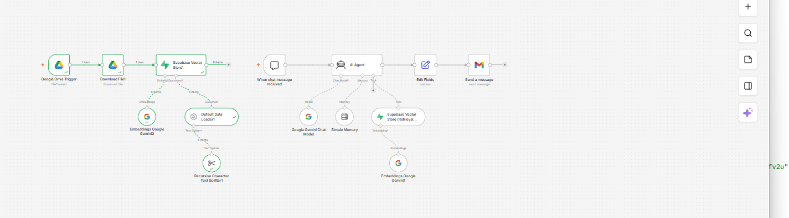
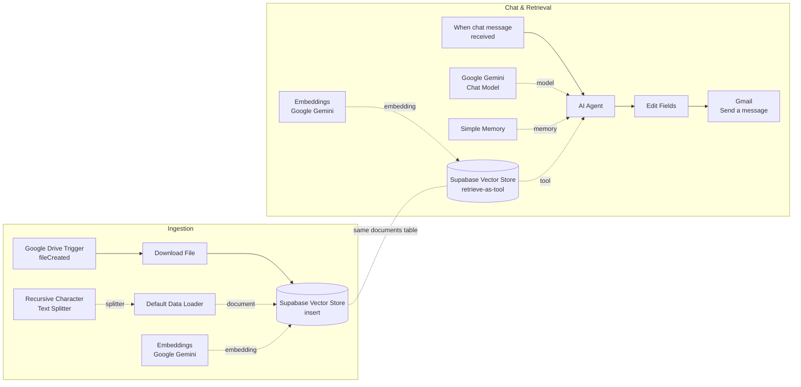

# n8n RAG Pipeline — 미래AI기술.pdf Q&A Agent

A Retrieval-Augmented Generation (RAG) workflow built in **n8n**. It ingests a PDF from Google Drive into a **Supabase** vector store using **Google Gemini embeddings**, then answers chat questions with a Gemini-powered AI Agent that retrieves relevant chunks from the document and emails the answer via **Gmail**.



---

## Overview

The workflow has two independent pipelines:

| Pipeline | Trigger | What it does |
|---|---|---|
| **1. Ingestion** | New file in a Google Drive folder | Downloads the PDF → splits it into chunks → embeds each chunk with Gemini → stores chunks + vectors in Supabase |
| **2. Chat & Retrieval** | Chat message in n8n | AI Agent searches the vector store → answers in Korean using the retrieved context → formats the answer → emails it |

**Example question:** `스몰데이터에 대해 설명해줘` ("Explain small data")

---

## Architecture



---

## Tech Stack

| Component | Tool |
|---|---|
| Workflow automation | n8n |
| Document source | Google Drive |
| Vector database | Supabase (Postgres + pgvector) |
| Embeddings | Google Gemini (`gemini-embedding-001`) |
| Chat model | Google Gemini (`gemini-3-flash-preview`) |
| Agent memory | n8n Simple Memory (window of 10 messages) |
| Output | Gmail |

---

## Repository Structure

```
.
├── README.md
├── workflow/
│   └── Task_2_RAG.json      # n8n workflow export (import this into n8n)
├── supabase/
│   └── setup.sql            # pgvector table + match_documents function
└── docs/
    └── workflow-canvas.png  # screenshot of the workflow
```

---

## Setup

### 1. Supabase
1. Create a Supabase project.
2. Open **SQL Editor** and run [`supabase/setup.sql`](supabase/setup.sql).
3. Note your **Project URL** and **service_role key** (Project Settings → API).

> The `embedding` column dimension must match your embedding model. Both embedding nodes in the workflow must use the **same** model.

### 2. n8n credentials
Create these credentials in n8n:

| Credential | Used by |
|---|---|
| Google Drive OAuth2 | Google Drive Trigger, Download File |
| Supabase API (Host = `https://<project-ref>.supabase.co`, service_role key) | Both Supabase Vector Store nodes |
| Google Gemini (PaLM) API | Chat Model + both Embeddings nodes |
| Gmail OAuth2 | Send a message |

### 3. Import the workflow
1. In n8n: **Workflows → Import from File** → select `workflow/Task_2_RAG.json`.
2. Reconnect each node to your own credentials (credential IDs in the export only work on the original instance).
3. In **Google Drive Trigger**, set the folder to watch.
4. In **Send a message**, set the recipient email.

### 4. Run
1. **Ingest:** Activate the workflow (or execute the Drive Trigger once), then upload `미래AI기술.pdf` to the watched folder. Check the `documents` table in Supabase for new rows.
2. **Ask:** Open the chat panel and send `스몰데이터에 대해 설명해줘`.
3. **Receive:** The answer is emailed with the subject `[RAG 답변] <question>`.

---

## How It Works

**Chunking.** The Recursive Character Text Splitter breaks the PDF into ~1,000-character chunks with a 200-character overlap so sentences that cross a boundary aren't lost.

**Metadata.** Each chunk is stored with `file_id`, `file_name`, `mime_type` and `source_url` from Google Drive, plus line locations from the loader.

**Retrieval.** The AI Agent calls the `future_ai_tech_docs` tool, which embeds the question and runs `match_documents` (cosine similarity) to return the closest chunks.

**Grounded answers.** The system prompt tells the agent to always search first, answer in Korean based on the retrieved content, and say so when the document doesn't contain the answer instead of guessing.

---

## Troubleshooting

Issues encountered while building this, and their fixes:

| Error | Cause | Fix |
|---|---|---|
| `Error inserting: TypeError: fetch failed` | n8n couldn't reach Supabase | Check the project isn't paused; Host must be exactly `https://<ref>.supabase.co`; use the service_role key |
| Same chunks appear 2–3 times in `documents` | Ingestion pipeline ran more than once | Run the de-duplication query in `setup.sql`; avoid re-running the Drive Trigger side |
| `404 … model … is no longer available to new users` | Gemini model retired | Pick a currently available model from the Chat Model dropdown |
| `expected N dimensions, not M` | Table vector size ≠ embedding model output | Recreate the table with the correct `vector(N)` size |
| Chat panel shows a message ID instead of the answer | Gmail is the last node, so its output is returned | Expected; the full answer is in the email |

---

## Possible Improvements

- Filter the Drive Trigger by filename or MIME type (IF node) so only PDFs are ingested.
- Delete a file's old chunks before re-inserting (`DELETE … WHERE metadata->>'file_id' = …`) to support updated documents.
- Add a "Respond to Chat" step so the chat panel shows the answer as well as the email.
- Send HTML-formatted emails with source references from chunk metadata.
